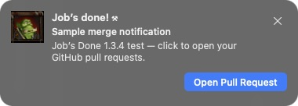

<p align="center">
  
</p>

<p align="center">A tiny macOS menu bar app for your GitHub PRs.<br>Open one: <b>“Work work.”</b> Merge one: <b>“Job’s done!”</b></p>

[Download](https://github.com/petzkod5/JobsDone/releases/latest) · [Help](SUPPORT.md) · [Contribute](CONTRIBUTING.md) · [Release notes](CHANGELOG.md)

## What it does

- Plays “Work work” when you open a PR and “Job’s done!” when it merges.
- Plays “Hmmm?” when someone else commits to your PR.
- Keeps recent PR links in the menu, with pause, mute, and repository filters.
- Uses your active GitHub CLI account, with separate history for each account.

It monitors **your authored PRs on github.com**, including private repositories,
every minute while your Mac is awake. Existing PRs stay quiet on first setup.

## Install

Requires **macOS 13+**. Release downloads support **Apple silicon and Intel**.

### Homebrew

```sh
brew install --cask petzkod5/tap/jobsdone
gh auth login --hostname github.com
```

Open **Job’s Done** from Applications. The cask installs GitHub CLI too.
This uses the project’s [Homebrew tap](https://github.com/petzkod5/homebrew-tap).

### Download a ZIP

Download `JobsDone-<version>-universal.zip` from the
[latest release](https://github.com/petzkod5/JobsDone/releases/latest), unzip it,
and move **Job’s Done.app** to Applications. Install GitHub CLI and sign in:

```sh
brew install gh
gh auth login --hostname github.com
```

Published releases use Developer ID signing and Apple notarization. Local
source builds are ad-hoc signed. Release ZIPs include a `.sha256` checksum file.

## Get started

1. Click the **Peon** in your menu bar and allow macOS notifications.
2. Use a notification test in the menu to check sound and banners.
3. Leave it running. Click an alert to open its PR.

Open **Settings…** with **Command-comma** to choose alert types, ignored
repositories, and **Peon Toast** or **macOS Notification** style. Pause and
**Open at Login** are in the Peon menu.



This is a real app capture from an earlier build. See
[screenshot notes](docs/screenshots/README.md) for capture details and limits.
[Usage details](docs/USAGE.md) cover history, filters, Focus, and keyboard access.

## Update or uninstall

Quit the app before updating:

```sh
brew update
brew upgrade --cask petzkod5/tap/jobsdone
```

For ZIP installs, replace the app with the latest download after quitting it.

To uninstall a Homebrew copy, quit it and run:

```sh
brew uninstall --cask jobsdone
```

For a ZIP copy, quit it and move the app to Trash. Saved history and preferences
remain on your Mac.

## Contribute

Start with [CONTRIBUTING.md](CONTRIBUTING.md) for local builds and PR checks.
Bug reports, fixes, and documentation improvements are welcome. Use
[Issues](https://github.com/petzkod5/JobsDone/issues) for bugs and ideas, or
[private reporting](SECURITY.md) for vulnerabilities.

## License and credits

Original code and documentation are [MIT licensed](LICENSE). Warcraft artwork
and audio belong to Blizzard Entertainment and are excluded from that license.
Sources and credits are in [THIRD_PARTY.md](THIRD_PARTY.md).
