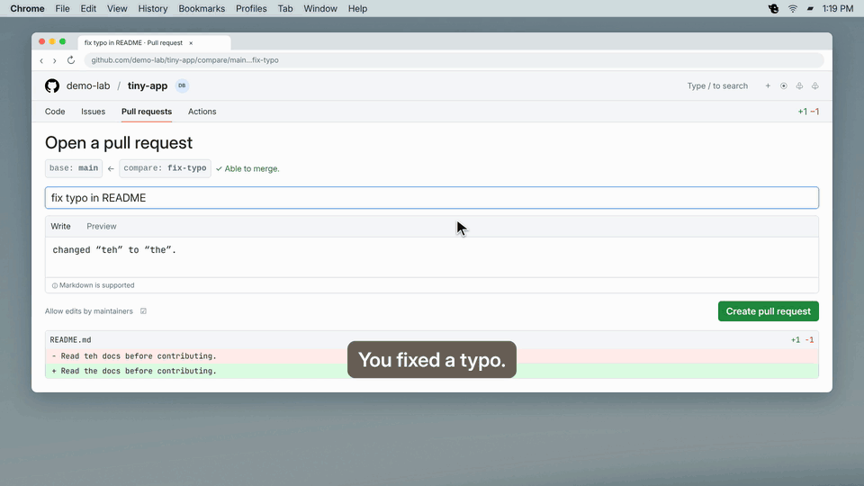

<p align="center">
  
</p>

<p align="center">
  <a href="https://github.com/petzkod5/JobsDone/releases/latest"></a>
  <a href="https://github.com/petzkod5/homebrew-tap"></a>
  <a href="LICENSE"></a>
  
</p>

A tiny Mac menu bar app that makes Warcraft noises at your GitHub PRs and issues.

Open one: **“Work work.”** Merge one: **“Job’s done!”**
Someone else commits to it: **“Hmmm?”**
An issue opens in a repository you own: **“Something need doing?”**

You hear about your PRs the moment they change, without keeping a GitHub tab
open or digging through email.



## Install

macOS 13+, Intel or Apple silicon. Requires [Homebrew](https://brew.sh).

```sh
brew install --cask petzkod5/tap/jobsdone
gh auth login --hostname github.com
```

Open **Job’s Done** from Applications, allow notifications, and leave it running.
It watches PRs you authored and issues opened in repositories you own, using
your active GitHub CLI account.

## Uninstall

Turn off **Open at Login** in the Peon menu, quit the app, then run:

```sh
brew uninstall --cask jobsdone
```

To also remove saved history and preferences:

```sh
rm -rf ~/Library/Application\ Support/JobsDone
defaults delete local.jobsdone.merge-monitor
```

[Help](SUPPORT.md) · [Settings and usage](docs/USAGE.md) · [Downloads](https://github.com/petzkod5/JobsDone/releases/latest) · [Contribute](CONTRIBUTING.md)

[MIT](LICENSE) for the code and docs. Warcraft art and audio belong to Blizzard
and are excluded; [credits here](THIRD_PARTY.md).
